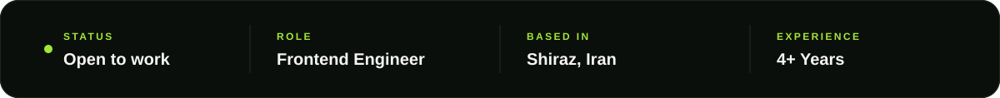
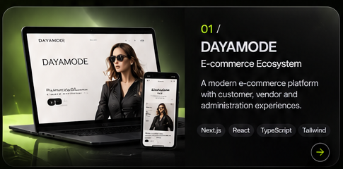
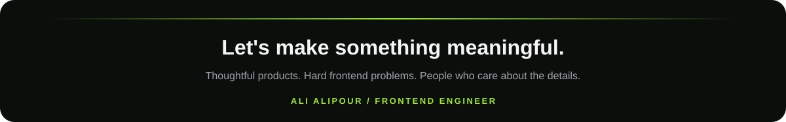

 

 

---

<table>
<tr>
<td width="62%" valign="top">

## ✳ ABOUT

I'm **Ali Alipour**, a frontend engineer. I design and build product interfaces with **React, Next.js, and TypeScript**.

The work usually spans the whole surface of a product: the customer experience, the vendor tools, and the admin system behind them. That includes RTL, performance, typed API clients, and a component architecture other people can keep changing.

I like software that stays calm as it grows. Structure first. Then the details that make it feel finished.

</td>
<td width="38%" valign="top">

## ✳ NOW

**Frontend Developer**  
Rayan Dadeh Noafarin

**BEFORE THAT**  
Freelance  
Invesweet  
Blackstudio

**FOCUSED ON**  
Product UI  
Design systems  
Performance and RTL

</td>
</tr>
</table>

 

---

## ✳ SELECTED WORK

*Two products. Multiple surfaces. Shipped.*

<table>
<tr>
<td width="50%" valign="top">

 

`Next.js` `TypeScript` `Tailwind CSS` `shadcn/ui` `Zustand` `TanStack Query` `Turborepo` `Docker`

 

</td>
<td width="50%" valign="top">

 

`Next.js` `TypeScript` `React Query` `Tailwind CSS` `shadcn/ui` `Zustand`

 

</td>
</tr>
</table>

---

## ✳ THE TOOLKIT

 

---

## ✳ CAREER

---

## ✳ CONTRIBUTION ARCHIVE

*One snake for 2026, 2025, and 2024.*

 

### 2026

<picture>
  <source media="(prefers-color-scheme: dark)" srcset="https://raw.githubusercontent.com/alialipourdev/alialipourdev/output/github-snake-2026-dark.svg" />
  <source media="(prefers-color-scheme: light)" srcset="https://raw.githubusercontent.com/alialipourdev/alialipourdev/output/github-snake-2026.svg" />
  
</picture>

### 2025

<picture>
  <source media="(prefers-color-scheme: dark)" srcset="https://raw.githubusercontent.com/alialipourdev/alialipourdev/output/github-snake-2025-dark.svg" />
  <source media="(prefers-color-scheme: light)" srcset="https://raw.githubusercontent.com/alialipourdev/alialipourdev/output/github-snake-2025.svg" />
  
</picture>

### 2024

<picture>
  <source media="(prefers-color-scheme: dark)" srcset="https://raw.githubusercontent.com/alialipourdev/alialipourdev/output/github-snake-2024-dark.svg" />
  <source media="(prefers-color-scheme: light)" srcset="https://raw.githubusercontent.com/alialipourdev/alialipourdev/output/github-snake-2024.svg" />
  
</picture>

 

---

 

  

THINK DIFFERENT. &nbsp; · &nbsp; BUILD BETTER. &nbsp; · &nbsp; KEEP CREATING.

