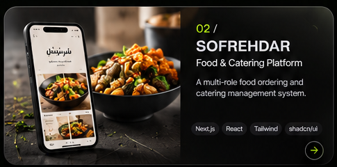

 

 

---

<table>
<tr>
<td width="55%" valign="top">

## ✳ About Me

I'm **Ali Alipour**, a Frontend Developer with **4+ years of experience** building scalable and responsive web applications.

I enjoy the intersection of engineering and design — creating clean architectures, thoughtful interfaces, and fast, reliable user experiences.

I care about the details, from reusable components and state management to accessibility, performance, and maintainability.

</td>
<td width="45%" valign="top">

## ✳ My Toolkit

**Also working with**

`Zustand` · `TanStack Query` · `React Hook Form` · `Zod` · `TanStack Table` · `shadcn/ui` · `Radix UI` · `MUI` · `Turborepo` · `pnpm` · `Biome` · `ESLint` · `Prettier` · `Jest` · `Cypress`

</td>
</tr>
</table>

---

## ✳ Selected Projects

<i>Real products. Real engineering.</i>

<table>
<tr>
<td width="50%" valign="top">

### 01 / DAYAMODE

**E-commerce Platform**

A multi-application e-commerce ecosystem with customer, vendor, and administration experiences.

**Stack**

`Next.js` `React` `TypeScript` `Tailwind CSS` `shadcn/ui` `Zustand` `TanStack Query` `Turborepo` `Docker`

- [Live Website](https://www.dayamode.com/)
- [Vendor Panel](https://dmseller.nrdn.ir/)
- [Admin Panel](https://dmadmin.nrdn.ir/)

</td>
<td width="50%" valign="top">

### 02 / SOFREHDAR

**Multi-Role Food Ordering & Catering Management**

A platform for food ordering and catering operations, designed around multiple user roles.

**Stack**

`Next.js` `TypeScript` `React Query` `Tailwind CSS` `shadcn/ui` `Zustand`

- [Admin Panel](https://panel.sofrehdar.com/)

</td>
</tr>
</table>

---

<table>
<tr>
<td width="50%" valign="top">

## ✳ Experience

**03/2026 — Present**  
Frontend Developer · **Rayan Dadeh Noafarin**

**09/2025 — 03/2026**  
Independent Frontend Developer · **Freelance**

**02/2025 — 08/2025**  
Frontend Developer · **Invesweet**

**07/2024 — 01/2025**  
Frontend Developer · **Blackstudio**

</td>
<td width="50%" valign="top">

## ✳ What I Focus On

- Scalable frontend architecture
- Responsive and RTL interfaces
- Reusable component systems
- State and server-data management
- UI/UX and performance optimization
- API integration and developer experience
- Monorepo workflows and tooling

</td>
</tr>
</table>

---

## ✳ The Contribution Universe

*Every contribution tells a story.*

<picture>
  <source media="(prefers-color-scheme: dark)" srcset="https://raw.githubusercontent.com/alialipourdev/alialipourdev/output/github-snake-dark.svg"/>
  <source media="(prefers-color-scheme: light)" srcset="https://raw.githubusercontent.com/alialipourdev/alialipourdev/output/github-snake.svg"/>
  
</picture>

 

---

# LET'S MAKE SOMETHING MEANINGFUL.

I'm always interested in good ideas, challenging projects, and great people to build with.

  

<a href="https://github.com/alialipourdev">GitHub</a>
&nbsp; · &nbsp;
<a href="https://linkedin.com/in/ali-alipour-037b37324">LinkedIn</a>
&nbsp; · &nbsp;
<a href="mailto:alialipour.dev@gmail.com">Email</a>

  

THINK DIFFERENT. &nbsp; · &nbsp; BUILD BETTER. &nbsp; · &nbsp; KEEP CREATING.

